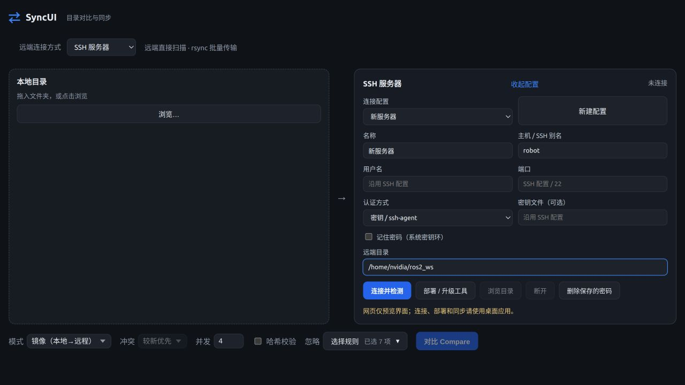

# SyncUI 0.2 交付与验证记录

记录日期：2026-10-27。功能已接入项目，按用户要求停止追加测试，由用户进行实际双机验收。以下仅汇总已经完成的检查，不代表所有故障注入与生产环境验收均已通过。

## 已交付功能

共享 Rust 核心、严格文件清单、独立静态 Agent、SSH 连接复用、密码/密钥/ssh-agent 认证、主机指纹确认、Secret Service 凭据存储、一键部署、rsync 精确上传下载、选中删除、文本编辑、取消、协议字节速度、逐项结果、诊断及单轮同步后刷新。旧挂载模式和设置读取继续保留。

## 已完成检查

| 范围 | 结果 |
|---|---|
| Rust 共享核心 | 30 项测试通过，包含原有引擎测试 |
| 桌面协调器与配置 | 5 项测试通过，包含旧设置兼容 |
| 前端 | TypeScript 与 Vite 生产构建通过；存在原有大 bundle 提示 |
| SSH 与传输 | 临时 OpenSSH 服务上完成双向传输、特殊文件名、精确选择、删除、版本复核及编辑 |
| 认证 | 加密私钥口令；独立密码服务器上错误密码恢复及密码登录；主机密钥变化拒绝 |
| 系统密钥环 | 独立 D-Bus/Secret Service 会话中保存、读取、删除通过 |
| 取消 | 正在传输的 rsync 取消后最终目标不存在、基线保持原值 |
| 协议 | 中断响应不能形成完整清单；版本不兼容拒绝 |
| 架构 | x86_64 原生运行；ARM64 经 QEMU 执行扫描、哈希、读取、保存、过期保存拒绝和删除 |
| 界面 | 浏览器中检查连接方式、认证切换与配置折叠；桌面连接由后端集成测试覆盖 |

SSH 集成执行记录见 [ssh-smoke.txt](validation/ssh-smoke.txt)。最新逐项状态返回、删除取消传递等收尾改动经过编译及单元检查，未重新跑完整 SSH 集成矩阵。磁盘满、长时间断网、真实桌面密钥环锁定/取消解锁、ARM64 实机运行仍需用户验收；新增接收端写入限制和密钥环不可用的测试脚本未在停止测试要求后继续运行。

## 性能记录

用户此前业务日志：远端挂载扫描 9,527 个文件约 **173.54 秒**。本次业务服务器 `192.168.3.72:22` 在 SSH 握手时关闭连接，未进入认证，也未在业务服务器部署或修改文件。因此尚无同目录、同忽略规则的 SSH 前后对照结果。

下面是本机 SSD、回环 SSH、10,000 个小文件、关闭哈希、复用连接的清单测试。两种扫描所得逐文件属性完全一致；它用于验证批量协议和量级，不能与业务挂载数据直接计算提速倍数。

| 轮次 | 顺序 | 本机扫描墙钟 | SSH 清单墙钟 | Agent 内部扫描 |
|---|---|---:|---:|---:|
| 1 | 本机 → SSH | 34.00 ms | 80.46 ms | 51.27 ms |
| 2 | SSH → 本机 | 39.75 ms | 68.84 ms | 55.50 ms |
| 3 | 本机 → SSH | 34.46 ms | 79.82 ms | 51.31 ms |

16 MiB 文件首次上传协议数据 **16,781,587 B**；修改其中 1 KiB 后再次上传，协议数据 **45,329 B**，文件完成量 **16,777,216 B**。目标文件内容核对一致。证明差量复用时网络计数与逻辑完成量已经分开。

正常双向小文件任务的日志只有一处“同步后刷新”，其后两端各扫描一次、合并基线并返回刷新差异。SSH 测试中的所有根路径均为临时本地磁盘路径，未使用 GVFS。

## 用户自行验收

在桌面选择 SSH 服务器，连接后部署 Agent，再填远端真实路径。建议先对独立测试目录操作，再使用业务目录。

实际性能记录建议保留相同忽略规则，交替进行挂载与 SSH 对比至少三轮，分别记录首轮与重复轮。再分别验证小文件、新大文件和局部修改大文件。对比结果和文件内容一致后再评价耗时。

| 场景 | 挂载模式 | SSH 模式 | 清单/内容一致 |
|---|---|---|---|
| 实际目录 第 1 轮 | 待用户填写 | 待用户填写 | 待确认 |
| 实际目录 第 2 轮 | 待用户填写 | 待用户填写 | 待确认 |
| 实际目录 第 3 轮 | 待用户填写 | 待用户填写 | 待确认 |

需要复现已完成的隔离检查时，脚本为 `scripts/ssh-smoke.sh`、`scripts/keyring-smoke.sh`、`scripts/agent-smoke.py`。SSH 脚本接收 sshd 可执行文件路径；密码分支需要测试机 Python 安装 paramiko，缺少时不会运行该分支。远端生产环境无需 Python。

## 界面预览

以下为浏览器布局预览；连接、部署与同步使用桌面应用。

